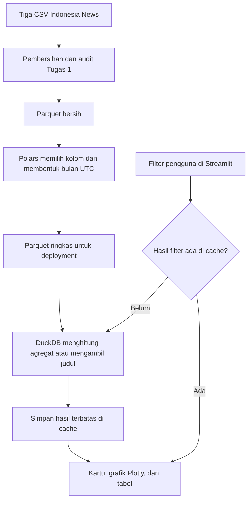

# Proposal Phase 1 — Jejak Liputan Indonesia

**Mata kuliah** Analisis Big Data · **Target check-in** Pertemuan 10

**Tim** Naufal Zainul Zaki dan Hanisah Aufa Khalidah

**Produk** Dashboard perbandingan liputan CNN Indonesia dan Tempo, 2014–2020

## 1. Masalah, pengguna, dan manfaat

Seorang peneliti media ingin mengetahui kapan suatu isu mendapat porsi liputan lebih besar di dua media. Membandingkan jumlah judul saja bisa menyesatkan. Dalam arsip bersih, Tempo memiliki 515.584 artikel dan CNN Indonesia 332.444 artikel. Media dengan arsip lebih besar bisa memiliki lebih banyak judul tentang isu yang sama sekalipun porsinya lebih kecil.

Dashboard ini ditujukan bagi peneliti media dan mahasiswa jurnalistik yang perlu memilih periode serta artikel untuk kajian lanjutan. Misalnya, pengguna memasukkan kata *banjir*, melihat perubahan porsi judul yang memuat kata itu pada masing-masing media, lalu membuka contoh judul pada bulan yang menarik untuk dibaca.

**Pertanyaan utama** adalah berapa persen judul pada setiap media dan bulan yang memuat kata atau frasa pilihan pengguna. Pencocokan menggunakan teks literal tanpa membedakan huruf besar dan kecil. Hasil dapat melewatkan sinonim dan memasukkan judul yang kebetulan memuat rangkaian huruf yang sama. Karena itu, tabel judul disediakan untuk memeriksa konteks. Kesimpulan berlaku untuk artikel yang tercakup dalam arsip.

## 2. Sumber dataset dan skala

| Parameter | Keterangan |
|---|---|
| Dataset dan sumber | Indonesia News, dihimpun oleh azizainunnajib. [Halaman dataset Kaggle](https://www.kaggle.com/datasets/azizainunnajib/indonesia-news) |
| Data mentah | Tiga CSV berukuran total sekitar 2,16 GB dengan 988.814 baris. Dataset memenuhi kriteria tugas melalui ukuran berkas di atas 500 MB. |
| Input analitik | Hasil pembersihan Tugas 1, `indonesia_news_clean.parquet`, berukuran 639.603.850 byte dengan 848.028 artikel menurut audit validasi. |
| Unit dan kolom | Satu baris per artikel yang dipertahankan setelah pembersihan. Dashboard menggunakan sumber media (`source`), waktu terbit (`published_at`), dan judul (`title`). |
| Cakupan waktu | 4 Agustus 2014–31 Mei 2020, berdasarkan interpretasi waktu UTC pada Tugas 1. Tahun 2014 dan 2020 hanya tercakup sebagian. |
| Jejak pengolahan | Notebook pembersihan Tugas 1 menyaring judul atau isi kosong, tanggal tidak valid, dan isi terlalu pendek, lalu menangani duplikasi berdasarkan media, judul, dan hash isi. Artikel dengan revisi isi dapat tetap terhitung. |

## 3. Arsitektur dan aliran informasi

Tahap persiapan berjalan sebelum deployment. Docker di Hugging Face Spaces menjalankan Streamlit dengan Parquet ringkas yang disiapkan untuk rilis. Aplikasi membaca berkas itu dari jalur data aplikasi sehingga tidak bergantung pada folder Tugas 1 di laptop anggota.

## 4. Pemrosesan, metrik, dan caching

**Polars.** Pada Phase 2, pipeline akan membaca Parquet bersih secara lazy, memilih tiga kolom yang diperlukan, menurunkan bulan dari waktu terbit, dan menulis Parquet ringkas. Jumlah baris keluaran dan total per media akan dicocokkan dengan audit Tugas 1 sebelum dipakai aplikasi.

**DuckDB.** Kueri membatasi media dan rentang bulan terlebih dahulu. Untuk setiap pasangan media–bulan, penyebut adalah seluruh artikel dalam cakupan filter tersebut. Pembilang menghitung judul yang cocok dengan satu frasa literal. Filter kata kunci diterapkan pada pembilang supaya penyebut tetap mewakili semua judul. Porsi dihitung sebagai 100 × pembilang / penyebut. Jika ada artikel tetapi tidak ada kecocokan, hasilnya 0%. Jika arsip tidak memiliki artikel pada media–bulan tersebut, grafik menampilkan celah. Saat kata kunci kosong, aplikasi menampilkan volume arsip dan meminta pengguna mengisi kata untuk melihat porsinya.

**Streamlit.** Fungsi kueri agregat memakai `@st.cache_data` dengan kunci versi dataset, media, rentang bulan, dan kata kunci yang dinormalisasi. Jumlah entri cache dibatasi. Tabel judul memakai kueri terpisah dengan batas 100 baris dan urutan tanggal serta judul yang konsisten. Session state hanya menyimpan pilihan pengguna.

## 5. Rencana tampilan dashboard

| Bagian | Isi dan interaksi |
|---|---|
| Sidebar | Pilih satu atau kedua media, bulan awal dan akhir, serta satu kata atau frasa. Tombol Terapkan menjalankan pencarian setelah pengguna selesai mengetik. |
| Ringkasan | Empat kartu menampilkan artikel dalam cakupan, judul yang cocok, porsi kecocokan gabungan, dan jumlah media dengan artikel dalam periode pilihan. Porsi gabungan memakai total pembilang dan penyebut seluruh media terpilih. |
| Tren liputan | Grafik garis bulanan dengan satu garis per media. Pengguna beralih antara jumlah dan persentase. Tooltip memperlihatkan jumlah judul cocok dan total artikel agar lonjakan dengan penyebut kecil terlihat. |
| Perbandingan media | Diagram batang menampilkan porsi kecocokan per media sepanjang periode pilihan. Tabel pendamping menampilkan jumlah judul cocok dan total artikel masing-masing media. |
| Pemeriksaan judul | Pengguna memilih media dan bulan untuk melihat hingga 100 judul beserta tanggal. Ringkasan bulanan lengkap sesuai filter dapat diunduh sebagai CSV. |

**Uji penerimaan untuk prototipe.** Tanpa pembatasan periode dan media, kartu volume harus menunjukkan 848.028 artikel. Mengganti kata kunci harus mengubah hasil pencocokan tanpa mengubah total artikel dalam cakupan. Pada contoh bulan Agustus 2014, arsip bulanan Tugas 1 mencatat 694 artikel CNN Indonesia dan nol artikel Tempo. Grafik persentase harus menampilkan celah untuk Tempo pada bulan itu.

## 6. Pembagian tanggung jawab

| Anggota | Phase 1 | Phase 2 | Phase 3 dan final |
|---|---|---|---|
| Naufal Zainul Zaki | Mendokumentasikan sumber, skala, dan arsitektur | Menyiapkan Parquet ringkas, kueri DuckDB, dan validasi jumlah | Mengintegrasikan Docker, menguji deployment, dan mendemonstrasikan pipeline |
| Hanisah Aufa Khalidah | Merumuskan kebutuhan pengguna, metrik, dan rancangan layar | Menyiapkan contoh filter dan memeriksa hasil agregasi | Membangun antarmuka Streamlit dan grafik Plotly, menguji alur pengguna, dan mendemonstrasikan dashboard |

Kedua anggota meninjau definisi metrik, mencoba prototipe di Spaces, serta menyelesaikan README dan video demo bersama.
